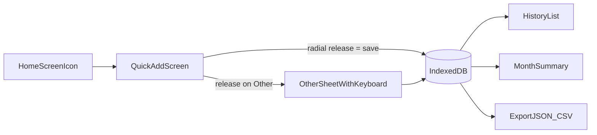

# Spendulum - Quick Expense PWA

## Goal
You open the app from the Home Screen, type an amount, press-slide-release on the category circle, and it's saved. It should take about 3 seconds. There is no login, no server, and no cost. Data stays on the iPhone and you can back it up by exporting a file.

## Stack
- **Vite + Preact + TypeScript**: small and fast to load, so the app opens near-instantly.
- **Dexie** (a library over IndexedDB) for storage on the device.
- **vite-plugin-pwa**: lets the app work offline and be added to the Home Screen.
- **Hosting**: GitHub Pages (free, HTTPS), deployed by GitHub Actions.



## Screens (3 tabs only)
1. **Add** (opens by default)
   - **Layout from top to bottom:** a large amount display, the round category button in the middle of the screen, then a built-in number keypad (0-9, ".", backspace).
   - **No iPhone keyboard on this screen.** The amount is typed on the built-in keypad, so the system keyboard never pops up. The amount display is not a text field.
   - While the circle is open, the keypad is dimmed and ignores touches.
   - **Radial category menu:**
     - One big round button sits in the middle of the screen.
     - Press and hold it, and 8 category icons pop out in a full circle around your finger.
     - Slide toward a category and lift your finger to save. The app picks the category from the direction your finger moves, and the slice under your finger enlarges as feedback.
     - Lifting in the centre cancels.
     - The menu stays inside the screen.
     - **No scrolling, zoom, text selection or long-press pop-ups while the circle is open.** The button and circle use `touch-action: none`, `user-select: none` and `-webkit-touch-callout: none`. The page also ignores touch movement while the circle is open.
   - **Default 8 slices:** Food, Transport, Groceries, Bills, Shopping, Health, Fun, and **Other**. Seven of these can be renamed or given a new icon in Settings; Other stays fixed.
   - **Other + sub-category:** this is the only time the iPhone keyboard appears. Releasing on Other opens a small sheet, and the keyboard opens immediately with the cursor in the sub-category / note field. Chips above the field show sub-categories you've used before. Tap a chip, or type a name and press Done, to save it as Other with that sub-category. Cancel closes the sheet without saving.
   - iOS only opens the keyboard when a text field is focused in direct response to a touch. So the sheet's text field always exists in the page (hidden until needed), and it gets focus at the moment your finger lifts on Other.
   - Optional: a small "note" field and a date change, hidden under a "more" toggle.
   - Undo: a toast shown for 5 seconds after saving.
2. **History**
   - Expenses grouped by day, with a total for each day.
   - Tap an entry to edit or delete it.
   - Filter by month.
3. **Summary**
   - This month's total and the total for each category, shown as simple bars.
   - Tap Other to see its totals by sub-category. From there you can move a sub-category's expenses into one of the main categories.
   - Arrows to move to the previous or next month.
   - Settings section:
     - Edit categories (names and emoji).
     - Currency, defaulting to LKR.
     - Export to JSON or CSV, which saves to the Files app or iCloud Drive.
     - Import from a JSON backup.

## Data model

```ts
expense { id, amount, categoryId, subCategory?, note?, createdAt, date }
category { id, name, icon, slot /* 0-7 position in the circle */, isOther }
```

## Reliability
- Call `navigator.storage.persist()` and only use the app from the Home Screen icon, so iOS doesn't clear the data.
- Show a monthly reminder banner: "Last backup: X days ago. Export now".

## Project layout
- `src/db.ts`: the Dexie schema and the read/write functions.
- `src/screens/Add.tsx`, `History.tsx`, `Summary.tsx`: the three tabs.
- `src/components/RadialMenu.tsx`: tracks the finger with pointer events and picks the slice from the finger's angle, ignoring movement inside a small dead zone at the centre.
- `src/components/Keypad.tsx`: the built-in number keypad.
- `src/components/OtherSheet.tsx`: the sub-category input and chips of previously used names.
- `src/App.tsx`: the tab bar.
- `vite.config.ts`: the PWA manifest (name, icons, `display: standalone`, theme colour).
- `README.md`: how to deploy and how to install on the iPhone (Safari > Share > Add to Home Screen).

## Local setup and hosting
- Location: `/Users/lahiru.kavinda/git-repos/spendulum`. Install Node LTS on the Mac; Docker, AWS and minikube aren't needed.
- Inside this repo only, set your personal git identity so commits don't use your work email: `git config user.name` / `git config user.email`.
- Push to a public repo on your personal GitHub, using a separate SSH key for that account.
- Add an MIT `LICENSE` so others can reuse the code.
- Hosting: a GitHub Actions workflow (`.github/workflows/deploy.yml`) builds the app and publishes it to GitHub Pages on every push to `main`. Set the Vite `base` option to `/spendulum/`.
- To test before pushing: `npm run dev` on the Mac.

## Validation
- Run `npm run build`, then preview it locally.
- Check that it still works offline after first load.
- Time the quick-add flow: typing the amount plus one press, slide and release should take about 3 seconds.
- Test on an iPhone in Safari:
  - No scrolling or text-selection pop-up while the menu is open.
  - All 8 slices can be picked reliably with a thumb.
  - The system keyboard never appears on the Add screen.
  - The keyboard opens straight away when you release on Other.
- Do an export and re-import round trip to confirm no data is lost.

## Out of scope (by your choice)
- SMS or bank integration, sync between devices, accounts, and charts beyond the simple bars.